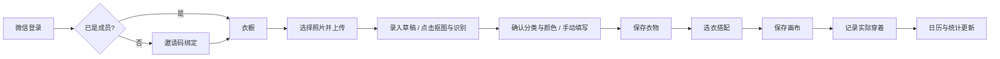

# 页面结构与交互设计

## 导航

自定义 TabBar 按首页、衣橱、中央新增「+」、搭配、我的排列：首页展示实况天气及可展开的三日预报；衣橱、搭配和我的为可用入口，中央「+」打开新增衣物页。穿搭日历整合到搭配页。图标全部引用 SVG 资源，选中态通过图标呈现与文字颜色区分。采用自定义 TabBar 以统一视觉和图标实现，保持微信返回、路由和安全区域行为。

## 页面清单

| 页面 ID | 页面/建议路由 | 内容与主要操作 | 关联功能 |
| --- | --- | --- | --- |
| P01 | 衣橱 `pages/wardrobe/wardrobe` | 搜索、分类、筛选、双列卡片、新增、批量管理、归档入口 | F02/F03 |
| P02 | 录入/编辑 `pages/clothing-edit/clothing-edit` | 选图/裁剪、处理状态、候选确认、资料、保存 | F02/F04 |
| P03 | 衣物详情 `pages/clothing-detail/clothing-detail` | 大图、资料、次数、最近穿着、收藏、编辑、归档、删除引用提示 | F03/F07 |
| P04 | 图片任务 `pages/image-jobs/image-jobs` | 批量项、等待/处理中/失败、预览结果、取消、重试 | F04 |
| P05 | 搭配 `pages/outfits/outfits` | 周历/展开月历、当天多套穿搭记录、独立分类新增与筛选、拼图卡片、收藏、新建 | F05/F06 |
| P06 | 搭配编辑 `pages/outfit-edit/outfit-edit` | 选衣抽屉、画布、布局工具、标题与标签、保存 | F05 |
| P07 | 搭配详情 `pages/outfit-detail/outfit-detail` | 展示图、单品列表、编辑、记录穿着、导出、试穿 | F05/F06/F11 |
| P08 | 日历（已整合到 `pages/outfits/outfits`） | 周/月切换、日期缩略图、选中日记录、补记 | F06 |
| P09 | 穿搭记录 `pages/wear-edit/wear-edit` | 日期、场景、搭配或单品、上身照、备注、保存/删除 | F06 |
| P10 | 统计 `pages/statistics/statistics` | 范围说明、数量、分类、费用与次数、少穿列表 | F07 |
| P11 | 清单 `pages/packing-lists/packing-lists` | 清单列表、新建、日期、复制 | F08 |
| P12 | 清单详情 `pages/packing-detail/packing-detail` | 衣物去重、收拾勾选、进度、添加、编辑日期 | F08 |
| P13 | 我的 `pages/profile/profile` | 个人资料、统计、清单、归档、标签、智能助手、设置 | F07–F13 |
| P14 | 分类与标签 `pages/taxonomy/taxonomy` | 分类/场景/风格标签、增删改、排序、引用迁移提示 | F09 |
| P15 | 设置与数据 `pages/settings/settings` | 城市、外部处理选项、导出状态、退出、注销 | F12/F13 |
| P16 | 智能搭配 `pages/recommendations/recommendations` | 城市天气、场景、允许衣物范围、生成、理由、保存 | F10 |
| P17 | 虚拟试穿 `pages/try-on/try-on` | 照片、搭配、发送说明、费用、状态、结果 | F11 |
| P18 | 登录 `pages/welcome/welcome` | 产品介绍、微信登录、邀请码、成员限制提示 | F01 |
| P19 | 首页 `pages/home/home` | 实况卡片、刷新、三日预报、微信位置优先、IP 识别与城市搜索 | F10 |

筛选、选衣、删除确认、邀请码输入可为页面内抽屉或对话框；原型用独立状态演示，微信实现不必为每个浮层新建路由。

## 核心流程

## 录入与处理

1. 衣橱“添加衣物”选择拍照或相册；批量选择后逐件录入，剩余项保持草稿。
2. 上传成功后展示当前照片，点击“抠图与识别”开始处理当前编辑的这一张。图片区域显示扫描动画和排队/处理阶段，文字资料可继续填写。
3. 处理完成后直接预览处理图；“查看对比”并排展示原图和处理图，点选决定当前表单使用哪张图片。
4. 分类候选和颜色建议在照片下方展示，点击后填入表单；手动填写的字段保持原值，最终点击保存写入衣橱。
5. 照片下方可直接裁剪当前选图。裁剪结果作为新的待保存照片，需要识别时再次点击处理入口。
6. 处理期间暂停换图、切换草稿、裁剪和保存；处理结束后恢复。暂时隐藏页面后返回会继续查询当前任务；退出录入页不取消服务端任务，历史结果可在“我的 → 图片处理任务”查看。
7. 请求失败和处理失败在本页显示可操作提示，原图可继续使用；上传和处理中的重复操作被阻止。

## 搭配编辑

- 进入后选择自己的正常衣物，自动排版；底部选衣抽屉支持分类筛选。
- 点选画布中的衣物显示编辑状态；拖拽移动，工具条调整大小、角度和层级。
- 指针/触摸结束后记录一次可撤销动作；图片位置约束在画布可见范围。
- 按钮提供自动排版、撤销、保存。保存中避免重复提交，离开未保存的修改时给出保留或放弃选择。
- 画布保存的是衣物 ID 与相对布局；服务器校验归属与数量，生成私有展示图。

## 日历与统计

- 日历以周一为一周起点；当前日描边、选中日浅蓝底与蓝色文字、有记录用蓝色小圆点，颜色之外提供文字/读屏说明。
- 日期切换后展示当天记录；未来日期允许查看，但实际穿着录入入口不可用并说明原因。
- 添加记录可选保存的搭配，也可直接选单品。保存时衣物集合成为本条记录的快照。
- 删除记录需确认；提交完成后更新记录数与统计，失败保留现状。
- 一件衣物同日多条记录统计为一天，界面明确说明口径。

## 状态矩阵

| 场景 | 页面表现 | 可执行动作 |
| --- | --- | --- |
| 初次加载 | 与布局匹配的骨架 | 可退出页面 |
| 无衣物 | 简短引导与 SVG 插画 | 添加衣物 |
| 搜索无结果 | 保留筛选条件，说明无匹配 | 清除筛选 |
| 网络错误 | 保留原内容、错误条 | 重试当前请求 |
| 会话过期 | 返回统一登录流程并保存可恢复的录入上下文 | 重新登录 |
| 不在成员名单 | 显示准入原因 | 输入邀请码/退出 |
| 图片排队 | 标明等待状态与批次顺序 | 查看、取消 |
| 模型处理失败 | 原图继续可用，显示原因 | 重试、使用原图 |
| 外部能力未配置 | 展示功能说明与不可用原因 | 返回普通搭配 |
| 服务额度不足 | 展示已知额度状态，阻止提交 | 修改操作或退出 |
| 删除存在引用 | 显示引用类型与数量 | 查看引用、归档 |
| 资源不存在或不属于用户 | 统一资源不可用提示 | 返回列表 |

## 原型交互覆盖

原型的场景切换器可以进入全部 18 个页面及空/错误/未配置状态；主流程支持搜索筛选、详情导航、录入字段检查、画布操作、日历选日与记录、清单勾选、智能结果演示。相册选择只在本机预览图片，网络、模型、微信登录、持久化及外部付费服务均用明确标识的演示行为表现。

## 可访问与真机适配

- 图标按钮有可读名称；状态与选中态同时提供文字或形状。
- 主要独立按钮点击区域至少 44×44 CSS px；紧凑日期网格按列宽铺满单元格，保持至少 44 px 行高，实际微信以设备与字号验证；核心表单字体不小于 16 CSS px 对应的设计尺寸。
- 覆盖 320、375、390、430 px 宽度；页面正文可滚动，底部操作与键盘之间保留安全距离。
- 照片预览不裁掉关键衣物区域；卡片用 contain 展示单品，生活照按封面裁切。
