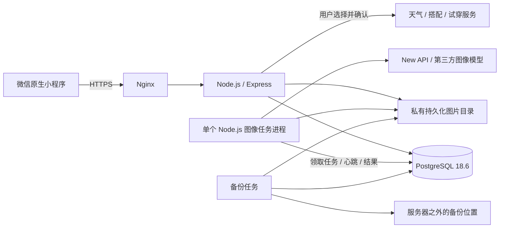
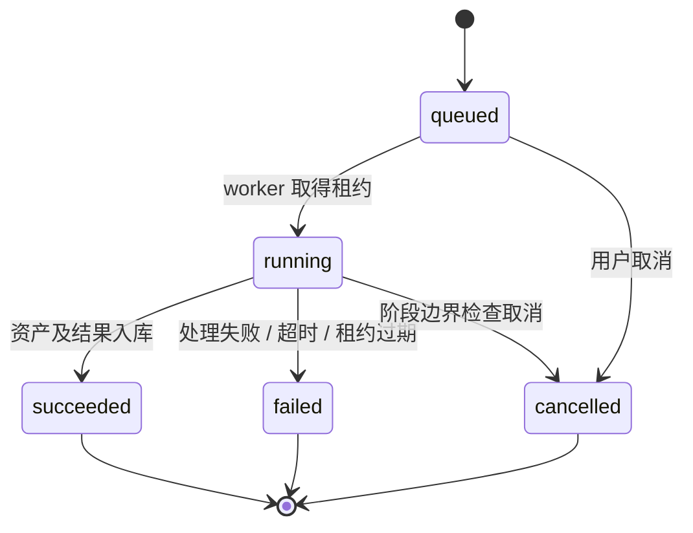

# 系统与部署设计

## 总体结构

普通接口和图像任务分进程运行，均使用 Node.js 与 TypeScript。worker 通过 New API 调用识别和抠图服务，使用 Sharp 整理图片、生成缩略图与搭配封面。模型、超时与密钥通过服务端环境变量配置。

## 组件职责

| 组件 | 职责 |
| --- | --- |
| Nginx | HTTPS、请求大小限制、反向代理、经后端授权的内部文件发送 |
| Express | 微信身份交换、会话与归属检查、业务接口、图片上传、外部服务调用、任务提交 |
| PG | 业务数据、会话摘要、邀请码摘要、图像任务状态、外部调用记录 |
| Node.js worker | 领取单个任务、调用 New API 识别与抠图、图片整理、缩略图、搭配封面渲染、写入结果 |
| 文件目录 | 原图、抠图、缩略图、画布图、上身照、导出文件；由数据库索引 |
| 备份任务 | 一致性备份、校验、异地复制、保留周期清理 |

## 资源初始配置与验证目标

资源配置是待实测的起点，不是已测结论：

- Express 与 worker 各单进程，各自 PG 连接池上限 5。
- 图像任务并发 1，识别与抠图按阶段顺序调用第三方服务。
- worker 容器初始内存上限 1024 MiB，触顶时记录任务失败/租约失效并回收，不能连带重启 PG 或 API。
- 原图解码限制 2400 万像素，处理时按接口要求缩放；图片后处理的峰值内存需在目标环境实测。
- 目标为任务执行时系统可用内存仍有至少 512 MiB、无 OOM、3 个并行用户的普通接口 P95 在服务端测试条件下小于 1 秒。
- 识别请求默认超时 60 秒，抠图请求默认超时 180 秒；分别记录阶段结果与调用耗时。
- 这些阈值都是设计验收目标；需确认 CPU 架构、MemAvailable、PG 当前配置和其他服务后再定容器限额。

图像效果与调用耗时以真实样本验证，接口协议与重试规则见[第三方抠图与衣物识别](11-ai-clothing-processing.md)。

## 任务执行与恢复

- 任务包含用户、输入资产、模型版本、阶段、租约截止时间、心跳时间、错误码和结果。
- PG 事务中用 `FOR UPDATE SKIP LOCKED` 领取最早排队任务并写入租约；同一 worker 同时只运行一项。
- 外部调用不占用 PG 长事务。领取和落结果分别短事务处理。
- worker 写临时文件，完成后原子重命名，最后事务写入资产记录与任务结果。
- 结果事务失败时记录待清理文件；定时对账只清理超过宽限期且无数据库引用的临时/孤立文件。
- 封面渲染与 AI 图像处理共享单任务队列，按提交的搭配版本绘制；新布局保存后，旧任务结果不能覆盖新封面。
- worker 定期心跳。重启发现租约过期则标记失败，用户显式重试创建新任务，保留原任务证据。
- 用户取消是状态请求，worker 在可中断的阶段边界处理；已成功的任务不能事后变成取消。
- 图像任务采用输入资产与任务类型去重，避免重复点击产生相同调用。主动重新处理可显式创建新任务。

## 私有媒体访问

- 普通 API 使用 Bearer 会话令牌，服务端只保存令牌摘要。
- 小程序 `image` 展示不能依赖任意自定义鉴权头。客户端先向受鉴权的签名接口请求短期 URL。
- 签名 URL 限定具体资产、用途和过期时间（初始 60 秒）；服务端验证签名后使用 Nginx `internal` 路径发送文件。
- 读取媒体时检查资产仍存在且所有者账号有效；注销/停用后拒绝访问。退出单个会话后已签发的URL在其剩余有效期内仍可能被访问，默认最多60秒。
- 签名 URL 是短期访问凭证，不记录在普通访问日志，不放入可公开分享的页面。返回 `Cache-Control: private, max-age=0, no-store`，客户端刷新失效签名后重载；敏感上身照/结果退出时清理本地临时文件。
- 所有图片列表只返回资产 ID，不泄露服务器绝对路径。
- 原图、处理图、上身照和生成结果均有所有者。请求不存在与请求别人资产返回一致的 404。

## 微信登录与会话

1. 客户端 `wx.login` 取得临时 code，发送到后端。
2. 后端使用 AppID/AppSecret 调用微信身份接口，取得身份，不把 AppSecret/session_key 返回客户端。
3. 已有成员创建会话；新身份返回需要邀请码状态，绑定时在事务内消耗邀请码并检查成员上限。
4. 会话由服务端生成随机令牌，存储摘要、用户、过期时间和撤销时间；默认 30 天有效是产品建议值。
5. 退出/注销/停用成员撤销会话。客户端处理 401，恢复可恢复的本地输入后重新登录。

## 外部服务与费用

- 天气采用[高德天气查询](https://developer.amap.com/api/webservice/guide/api-advanced/weatherinfo)，通过后端请求 `https://restapi.amap.com/v3/weather/weatherInfo`，设置 `city=adcode`，并行请求 `extensions=base` 实况与 `extensions=all` 预报；实况取当前气温、天气、湿度、风向风力和发布时间，预报取今天、明天、后天的昼夜天气与温度。微信 `wx.getLocation` 使用 GCJ02，经纬度按“经度,纬度”保留六位小数后传入高德 `/v3/geocode/regeo`，取得行政区编码；精确位置不落库。
- 高德 Web 服务密钥由服务端环境变量 `AMAP_KEY` 提供，不进入小程序包或日志。按查询位置共同缓存实况和三日预报 10 分钟，上海时区跨日失效；`refresh=true` 绕过有效缓存重新请求。同日供应商请求失败时可返回保留原发布时间的 `stale=true` 缓存。单次查询共享 10 秒上游超时，涵盖定位与天气请求。实际额度与权限以高德账号为准。
- 客户端自动按微信位置、IP、手动城市的顺序确定查询位置。微信获取失败或坐标无法解析城市时改用 IP；IP 无法识别时结束自动获取流程，城市选择面板由用户点击卡片城市打开。已选城市用于后续天气刷新，切换城市后的旧定位回调和请求不得覆盖新结果。
- IP 自动查询由 Express 根据 `TRUST_PROXY` 确定用户公网 IPv4，显式传入高德 `/v3/ip`，取得 `adcode` 后查询天气。直连不信任代理头；私网、本地、IPv6 和无城市结果返回可手选的错误。地点搜索使用 `server/src/weather-locations.ts` 内置的高德官方行政区编码目录，按中文、拼音及行政归属筛选并稳定分页，不调用外部搜索接口。
- 衣物识别与抠图通过 New API 调用，模型与密钥由服务端配置；AI 搭配与试穿服务仍待选定。
- 请求提交前检查应用总额度和用户额度，事务预占额度并记录幂等键；调用后按真实收费结果结算。
- 发起重试先查询供应商任务 ID；状态不明时显示“等待确认”，不能盲目重新创建付费任务。
- 供应商回调验证签名并幂等处理；轮询作为选定提供商的明确协议实现，不预留无需求的通用插件体系。
- 用户发起图像处理后发送当前照片；调用失败保留原图、已成功的阶段结果与错误状态。

## 镜像升级与自动数据库迁移

用户确认的交付体验：首次配置数据库连接、凭据与持久化目录后，后续导入发布镜像并运行更新命令，数据库脚本由容器启动流程自动执行。发布包提供固定部署配置与更新入口，不要求用户进入容器或手动运行 SQL。

启动顺序：`数据库可连接 → 取得迁移锁 → 校验历史 → 执行待应用迁移 → 释放锁并退出迁移进程 → 启动 Express → 就绪 → 启动新版 worker`。

- 后端镜像内置迁移工具和截至该版本的完整迁移文件，不在启动时联网下载工具或脚本；工具精确版本及兼容性实测结果记录在根 README。
- 默认执行自动迁移，不要求用户追加 migrate 参数。数据库尚未就绪时仅进行有明确时限的启动等待；超时退出并记录连接失败原因，不记录凭据。
- 迁移历史保存在项目数据库中，容器替换后保留。空库自动初始化；已有库只执行缺失迁移；同版本重启仅校验历史。
- 迁移使用数据库级互斥，覆盖历史校验和执行；并发启动不能重复应用同一变更，等待锁有超时。工具原生锁能力满足要求时直接使用，不另建重复机制。
- SQL 失败、校验和不符、数据库版本超出镜像支持范围时，启动失败且 API 不监听业务端口；日志包含迁移版本和错误原因，容器非零退出。部署配置限制自动重启次数，不反复重跑失败迁移。
- 单机更新入口先停止旧 API 和旧 worker，等待在途任务结束或按已有租约恢复机制处理，再启动新版。新版 worker 仅在新版 API 就绪且结构版本匹配后领取任务；不能仅凭 PG 可连接就开始工作。本方案允许短暂停服。
- 更新入口检查可用备份并按部署约定生成升级前备份，再替换服务；数据库与媒体挂载保留。更新不删除卷、不重建已有 PG 实例，不自动升级 PostgreSQL 引擎版本。
- 常规自动迁移使用事务内支持的 DDL/DML；非事务变更必须先设计中断恢复方式并单独验证。迁移成功后的应用启动失败不自动逆向执行 SQL，回退镜像仅限已验证兼容当前结构的版本。
- 不自动执行 clean、repair 或对未知已有结构执行 baseline。破坏性变更需按项目规范取得授权并完成备份方案，不能借自动启动绕过授权。

首次部署需要可用于项目库结构变更的迁移凭据；可与业务凭据分别通过环境配置提供，不授予整个 PG 实例的超级用户权限。迁移工具暂以 Flyway 为候选，接入时验证镜像体积、启动峰值和目标平台兼容性；当前尚无可执行容器入口。

## 文件、备份与上线

- 应用与 worker 共享受控媒体挂载目录；代码镜像只读，日志按大小轮转。
- PG 18 官方容器卷目录需按选定镜像说明核对。复用现有数据库，不改动用户已有 PG 数据卷或其他库。
- 备份先取得数据库一致性快照并生成关联资产清单，再备份这些不可变文件；文件清理与备份窗口协调。
- 导出文件 24 小时清理；已失去引用的媒体按清理任务删除；保留历史的归档图片继续保留。
- 上线前落实域名、HTTPS、微信合法域名、AppID、成员邀请码、异地备份位置、外部服务和费用配置。
- 微信体验版还是正式版由账号条件决定；无论发布方式如何，服务端都执行成员准入。

## 依据

- [第三方抠图与衣物识别](11-ai-clothing-processing.md)：New API 协议、模型配置、图片规格与阶段恢复。
- 资源观测来自用户在本次会话提供的服务器截图；未连接服务器执行测量。
