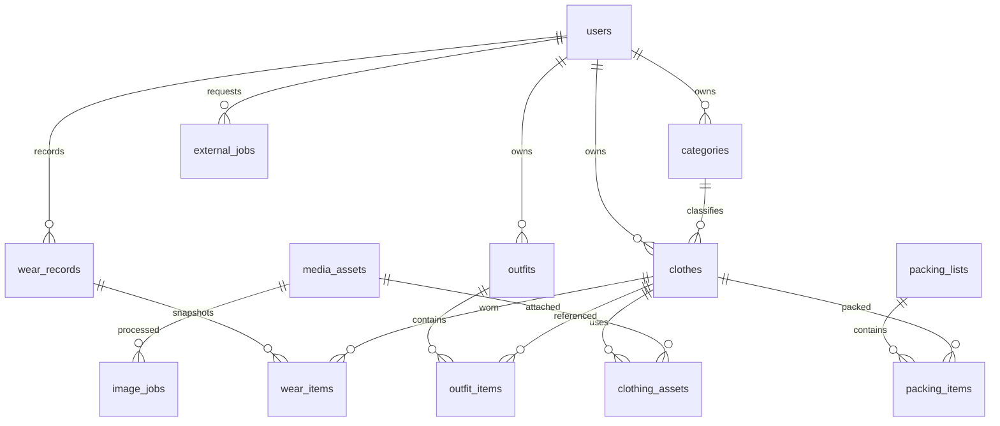

# 数据模型与业务约束

本文件为逻辑数据设计，尚未执行 DDL。初始迁移依此生成并在独立 PG 18 测试库验证。

## 共通约定

- 业务主键为 UUID，服务端/数据库生成；API 中为字符串。时间点用 `timestamptz`，自然日用 `date`。
- 金额用整数分（`bigint`），API 以十进制字符串传递 `priceCents`；输入解析为人民币金额，显示换算为元。
- 所有用户资源带 `user_id`。业务表增加 `UNIQUE(user_id, id)`，关联用复合外键 `(user_id, resource_id)`，在数据库层阻止跨用户引用。
- JSONB 只用于画布布局参数、模型结果、外部服务的有限元数据；可查询的核心关系用关联表。
- 用户可修改的记录有 `version integer`，PATCH 提交版本，更新用 `WHERE user_id=$1 AND id=$2 AND version=$3`，冲突返回 409。
- 归档是业务状态，永久删除使用真实删除及引用检查；统一记录创建/更新时间，不预设全表软删除。

## 表与字段

| 表 | 核心字段 | 约束与索引 |
| --- | --- | --- |
| users | id, wechat_openid, nickname, avatar_asset_id, city_code, timezone, preferences, status, version, created_at | openid 唯一；status 为 active/disabled/deleting |
| sessions | id, user_id, token_hash, expires_at, revoked_at | token_hash 唯一；过期与用户索引 |
| invitations | id, code_hash, expires_at, consumed_by, consumed_at | code_hash 唯一；绑定事务中一次消耗 |
| categories | id, user_id, name, sort_order, version, created_at | 用户内名称唯一；默认分类复制给每位用户 |
| tags | id, user_id, kind, name, sort_order, version | kind=occasion/style；用户、类型、名称唯一 |
| clothes | id, user_id, category_id, name, status, primary_asset_id, colors, seasons, brand, size_label, material, price_cents, purchased_on, notes, favorite, version, created_at, updated_at | status=draft/active/archived；active 分类/主图必填；价格非负；用户+状态+创建时间索引 |
| clothing_tags | user_id, clothing_id, tag_id | clothing/tag 复合归属外键；三列唯一 |
| media_assets | id, user_id, kind, storage_key, mime_type, width, height, byte_size, parent_asset_id, status, created_at | storage_key 唯一；kind=original/cutout/thumbnail/outfit-cover/body-photo/generated/export；status=temporary/ready/deleting；用户+父资产索引 |
| clothing_assets | user_id, clothing_id, asset_id, role, sort_order | 同用户复合外键；主图/细节图关系明确 |
| image_jobs | id, user_id, input_asset_id, clothing_id, outfit_id, request_key, request_hash, kind, status, phase, cancel_requested, lease_expires_at, heartbeat_at, model_revision, attempt_of, result, error_code, created_at, started_at, finished_at | kind=process/cutout/classify/outfit-cover；图片任务要求输入资产，封面任务要求搭配和布局版本；用户+路由+request_key 唯一；排队状态部分索引；同输入活动任务去重；引用同用户资源 |
| outfit_categories | id, user_id, name, created_at | 本人名称唯一，1–12 字；用户+创建时间+ID 索引 |
| outfits | id, user_id, name, category_id, occasion, seasons, notes, favorite, background_color, cover_asset_id, version, created_at, updated_at | 用户+创建时间索引、分类列表索引；分类和 cover 均为同用户资源；分类允许为空 |
| outfit_items | user_id, outfit_id, clothing_id, x, y, width, height, rotation, z_index | 同一搭配同一衣物唯一；位置尺寸为归一化数值，尺寸为正；衣物删除 RESTRICT |
| wear_records | id, user_id, worn_on, occasion, source_outfit_id, notes, body_asset_id, version, created_at | 用户+日期索引；source_outfit 可 SET NULL（复合外键仅置空 source_outfit_id，保留 user_id），实际单品由 wear_items 保存 |
| wear_items | user_id, wear_record_id, clothing_id, name_snapshot, category_snapshot | 每条记录同一衣物唯一；引用 clothing RESTRICT |
| packing_lists | id, user_id, name, start_on, end_on, version, created_at | 日期范围合法；用户+创建时间索引 |
| packing_items | user_id, packing_list_id, clothing_id, packed, sort_order | 同一清单衣物唯一；同用户复合外键 |
| external_jobs | id, user_id, kind, status, provider, provider_job_id, request_key, request_hash, consent_at, input_summary, result, estimated_cents, settled_cents, error_code, created_at | kind=recommendation/try-on；用户+request_key 唯一；provider+provider_job_id 联合唯一（非空） |
| data_exports | id, user_id, status, request_key, request_hash, asset_id, expires_at, error_code, created_at | 用户+request_key 唯一；到期时间索引；资产同用户 |

派生图像沿 parent_asset_id 关联原图；衣物主图可指向已确认的抠图。外部任务结果只保存受控字段和私有结果资产 ID，避免将供应商临时 URL 当长期媒体地址。

## 主要关系

## 画布坐标

画布逻辑比例 3:4。x/y 表示未旋转元素包围盒的左上角，范围 0–1；width/height 表示相对画布的包围盒比例；rotation 围绕元素中心旋转，以角度表示，z_index 为整数。服务端校验元素存在、归属、数量与数值范围。缩放保持衣物图像自身比例，保存前用统一算法计算布局。

导出画布建议 1080×1440，白底或用户选定纯色；透明衣物置于画布。布局 JSON 与 outfit_items 不能各自成为独立真相，采用关系行作为持久化来源。

## 统计查询口径

- 单件穿着次数：`COUNT(DISTINCT wear_records.worn_on)`，关联 wear_items，并始终限制当前用户。
- 最后穿着：`MAX(worn_on)`，没有记录为 NULL。
- 活跃衣橱金额：正常衣物中 `price_cents IS NOT NULL` 的求和，同时返回有价件数和总件数。
- 单次成本：有价格且次数大于 0 时计算，展示保留两位小数；PG 保持精确金额，API 不返回 NaN/Infinity。
- 删除或修改 wear_records 后自然重新查询，不手动增减一个容易漂移的穿着计数器。
- 初始规模采用直接查询；性能不足以真实执行计划为依据优化索引。

## 写入事务

| 操作 | 事务范围 |
| --- | --- |
| 邀请码绑定 | 锁定邀请码、验证有效性、检查成员上限、创建用户和默认分类、消耗邀请码 |
| 保存搭配 | 检查版本和所有衣物归属，更新 outfits，替换 outfit_items，提交带搭配版本的封面生成任务；旧版本封面结果不可覆盖新版本 |
| 保存穿搭 | 验证日期/衣物，写记录及快照项；源搭配仅作来源关联 |
| 保存清单 | 验证衣物并去重，写清单与项目 |
| 领取任务 | 锁定待运行任务，写 running/lease/heartbeat |
| 图片完成 | 登记输出资产、记录模型结果、任务成功；不自动覆盖用户已编辑字段 |
| 永久删除衣物 | 检查引用，删除关系和衣物，登记待清理媒体；文件删除在提交后执行 |
| 账号注销 | 标记 deleting、撤销会话；清理器持续扫描该状态，按外键依赖清理数据和媒体 |

## 生命周期

- 上传文件以临时名称落盘，登记成功后成为可引用资产；无引用临时资产超过 24 小时清理。
- 归档保留衣物、照片及历史关系。
- 永久删除被搭配/日历/清单引用的衣物返回 409 `RESOURCE_REFERENCED` 及可展示引用数量。
- 用户删除一条历史穿搭后，其独占上身照可清理；共享引用的资源以引用检查为准。
- 删除账号清理全部该用户数据；备份按已告知的周期到期清理。

## 迁移与验证

初始 SQL 迁移覆盖结构、约束、索引与状态检查；迁移脚本记录文件名/校验和/执行时间。分别验证空库初始化、重复执行识别、事务失败回滚、跨用户关联拒绝、历史引用删除保护。迁移不连接现有生产库执行实验。

迁移随后端镜像交付并由容器入口自动执行，成功后才启动业务进程。文件采用工具约定的有序命名（Flyway 候选示例：`V1__init_schema.sql`），已发布文件保持不变，修正通过新增版本完成。校验历史及应用新迁移受同一迁移互斥机制保护。

每个发布镜像声明其目标结构版本，启动时检查数据库历史与镜像迁移集合一致；数据库领先于镜像时拒绝未经验证的降级。事务失败回滚针对当前迁移，不能声称整次跨多个迁移文件的升级全部回滚；已成功提交的迁移保留记录，修复后从未完成项继续。完整流程见[自动数据库迁移](04-architecture.md#镜像升级与自动数据库迁移)。

## 轻量后台作业与额度一致性

- 账号清理直接扫描 `users.status=deleting`，文件清理扫描 `media_assets.status=deleting`，通过状态恢复和幂等删除持续推进，不额外引入消息中间件。
- 清理媒体前检查衣物、搭配、日历、任务输入与结果引用；运行中任务取消并到达终态后才能释放输入。模型结果落库须再次检查任务状态与租约，迟到结果只登记为待清理资产。
- 外部额度由部署配置给出，每次提交在 PG 事务内取得应用级 advisory lock，汇总该日 `external_jobs` 已结算费用与未结算预占费用后判断余额，再写新任务；2–3 人场景不增加独立计费平台。provider 状态未知时继续占用预留额度，人工/查询确认后结算。
- `request_key` 记录接口作用域，`request_hash` 为规范化请求摘要。重复 key 同体返回原任务，异体返回冲突；幂等记录至少保留至任务终态和客户端可重试窗口结束。
- 标签在衣物通过关联表连接；搭配/穿搭的 occasion 是当时的场景文本快照，改名不追改历史。`users.preferences` 仅保存明确允许的展示/季节偏好字段，不保存任意客户端配置。
- 邀请码消费与成员上限检查取得同一应用级事务锁，避免两个邀请码同时绑定越过人数上限。
