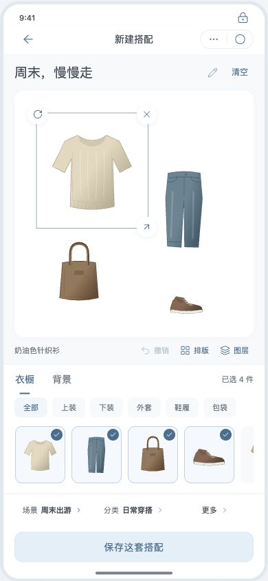

# 新建搭配 · 画布编辑设计

设计日期：2026-11-14。已按用户确认方向实施小程序页面，页面操作与真机验收待完成。

[打开交互设计稿](prototype/outfit-create.html)。设计稿使用项目已有示例衣物，保存仅在页面内演示。

## 页面结构

1. 顶部保留微信导航与返回；搭配名称直接编辑，右侧为清空。
2. 中部为主要画布，占据选衣区域上方的可用高度。白色默认背景，不放常驻说明文字。
3. 画布下沿显示选中衣物名称，右侧为撤销、排版、图层。
4. 底部选材区包含衣橱、背景两个入口。衣橱内按分类筛选，缩略图横向滚动，已加入衣物显示勾选。
5. 场景、搭配分类、更多设置集中为一行；保存按钮固定在底部安全区域上方。

沿用「晴空蓝白」主题：白色主底、灰蓝文字、淡蓝选中状态、统一细线 SVG 图标。参考图用于画布与选材结构，不代表需要引入其中全部编辑功能。

## 核心交互

| 操作 | 结果 |
| --- | --- |
| 初次进入 | 空白画布、自动生成可编辑的默认名称，至少添加一件衣物后允许保存 |
| 点击衣物缩略图 | 加入画布并选中；已加入的衣物只切换选中，不重复添加 |
| 拖动画布衣物 | 调整位置；衣物保持在画布范围内 |
| 点击空白画布 | 收起选中框和单品工具 |
| 选中衣物 | 显示左上旋转、右上移除、右下等比缩放操作 |
| 打开图层 | 按前后顺序列出衣物，可选择单品、置顶和置底 |
| 点击排版 | 为当前单品重新提供整齐布局，可撤销 |
| 点击清空 | 底部确认面板，确认后清空；仍可撤销 |
| 点击背景 | 显示纯白、晴空蓝、浅灰、米白四个色块，直接更新画布 |
| 点击场景或搭配分类 | 底部列表选择，明确显示当前值；分类沿用已有用户分类与新增能力 |
| 点击更多 | 底部面板编辑季节和备注 |
| 点击保存 | 校验名称与至少一件衣物，保存期间禁用重复提交，成功进入详情 |

真实新建从空画布开始；设计稿首次展示四件示例衣物，用于评审排版与选中操作。正式实现沿用最多 12 件的现有约束。

## 状态与移动端细节

- 衣橱初次加载显示缩略图骨架，不提前显示空衣橱。
- 空衣橱显示添加衣物入口；筛选无结果显示当前分类暂无衣物。
- 加载失败在选衣区显示重试；已有画布和已加载的衣物保留。分页失败只重试下一页。
- 未选中衣物时收起单品操作；空画布时禁用清空、排版、图层与保存。
- 名称较长时在单行输入内编辑；场景和分类较长时截断，选择面板展示完整名称。
- 工具可见尺寸保持轻巧，正式实现的有效触摸区域至少 44px；选中框靠近边缘时将工具收进画布。
- 选衣区独立横向滚动，画布拖动不带动整页。短屏适当压缩画布高度，保留选衣和保存入口。
- 返回时提示未保存修改；备注和季节在面板确认后写入草稿，取消不改变内容。

## 实施边界

小程序编辑页已采用本提案的信息结构。正式编辑画布保持原有 3:4 比例，在可用编辑区域内居中放大，与详情、封面生成和导出保持一致。

修改范围为 `miniprogram/pages/outfit-edit/` 的 TypeScript、WXML、WXSS 和页面配置，现有 `outfit-category-bar` 增加底部列表展示方式，并补充 `miniprogram/assets/icons/resize.svg`。复用衣物、衣物分类、场景、搭配分类和保存接口，保留背景、季节、备注与画布数据契约。

素材、文字贴纸和温度范围需新增编辑对象或字段，另行确定需求后设计。当前优先完整覆盖衣橱拼搭。

## 当前验证

- 浏览器已检查添加衣物、分类筛选、旋转、撤销、背景、场景、图层顺序、清空确认和空画布保存禁用。
- 已通过真实指针拖动检查位置更新；320px、390px 页面无横向溢出，图像加载正常。
- 已检查衣橱正常、骨架加载、空衣橱、失败重试的展示。
- 以上检查针对 HTML 设计原型；小程序实现的验证范围见下文。

### 小程序实现检查

- 小程序严格类型检查通过，受影响 TypeScript 已转译为 ES2015 CommonJS。
- `npm run build:wechat` 通过；官方 `wcc`、`wcsc` 对受影响页面和分类组件的模板、样式编译通过。
- 本轮未执行微信页面操作、视觉或真机检查。
- 用户测试：进入新建搭配，选衣、切换分类、拖动、旋转、缩放，检查图层置顶/置底及清空撤销；修改背景、场景、分类、季节和备注后保存，再进入编辑核对是否保留。取消设置面板时检查草稿未被写入。
- 状态测试：加载中显示骨架，空衣橱和空分类显示各自提示，断网或分页失败保留画布和已加载衣物并允许重试；开发者工具与真机均检查新增 SVG、画布边缘操作和底部安全区域。
