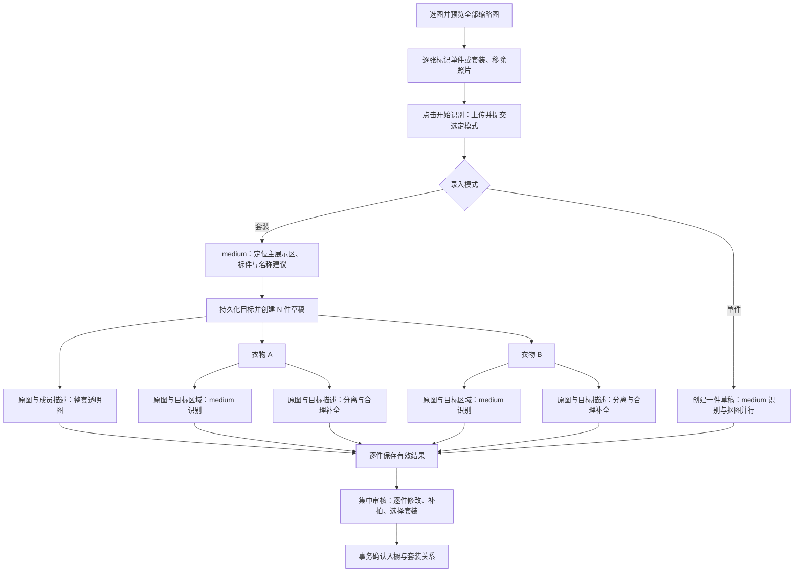

# 多件衣物识别与套装

日期：2026-11-15。状态：已实施，类型检查、后端构建、真实 PG/HTTP 与单次远端样本验证完成；微信页面与真机验收待用户执行。第 11 节记录当前套装补全与整套透明图方案；第 9、10 节为历史验证。

## 1. 目标与已确认规则

一张照片可以录入多件独立衣物。照片中的套装拆成成员衣物，每件有自己的分类、资料、图片和穿着记录，同时保留套装关系。

- 识别使用 `gpt-6-luna`，`reasoning_effort=medium`。
- 选图后先展示全部缩略图，用户标记“单件 / 套装”、移除不需要的照片，点击“开始识别”后才上传并创建 AI 任务。上传资产本身不触发模型。
- 同一照片中，定位完成后的每件衣物，其资料识别与补全图生成并行；同图最多同时处理两件，并行生成一张整套透明图。
- 识别依据原图及目标区域，不等待抠图完成。
- 套装成员允许依据可见结构合理补齐遮挡部分，保留颜色、纹理和款式，隐藏结构只做简单延续；审核时可查看原图、修改或补拍。
- AI 生成的是可编辑草稿，审核后才入橱、建立套装关系。
- 衣橱提供独立的“套装”栏目，展示整套图和成员单品；任一成员详情可查看所属套装和其他成员。

同图出现多件衣物不等于属于同一套装。用户预选“套装”表达录入意图，AI 负责定位成员和建议名称，审核后确认实际关系；普通穿搭中的裤子、包等不因同框而自动归为套装。图片文字可作为商品信息线索，不能作为指令或套装归属的唯一依据。

## 2. 用当前截图说明结果

以下为当前截图对应的两个独立目标；补全样本结果见第 11 节：

| 草稿 | 识别目标 | 分类处理 | 图片处理 |
| --- | --- | --- | --- |
| 衣物 A | 下方模特的长袖碎花针织开衫 | 单独推断并匹配用户已有分类 | 仅保留外层开衫，移除内搭、模特和背景 |
| 衣物 B | 下方模特的无袖纽扣上衣 | 独立判断背心或吊带等品类，不从开衫复制分类 | 分离内搭并合理补齐被遮挡的肩带、侧边和衣身，可补拍 |

上方穿搭参考图中的裤子和包不作为这次主商品目标；同一衣物在拼图中重复展示时，选择一处主体来源，不重复创建衣物。无法确定主展示区时停在待核对，用户可补录清晰照片，或取消后按单件重新提交；本版未提供手选区域界面。

AI 可建议套装名称“深灰碎花两件套”，审核页显示两件草稿并提供“保存为套装”。关闭后，两件仍可分别入橱。

两件衣物独立分类不意味着必须属于不同一级分类。针织开衫与背心可能都在“上衣”下面，但对应不同二级品类；“内搭”是穿法，不能代替具体品类。一级分类继续尊重用户已有目录和照片依据。

## 3. 三种业务对象

| 对象 | 含义 | 独立行为 |
| --- | --- | --- |
| 衣物 | 一件开衫、一件背心等单品；一双鞋仍算一件 | 分类、编辑、收藏、归档、穿着、搭配、统计 |
| 套装 | 有明确成套关系的衣物集合 | 独立列表、整套图片、命名、查看成员、增减成员、解散 |
| 搭配 | 用户为某次穿着组合的衣物 | 延续现有搭配与日历逻辑，同一单品可用于多套搭配 |

本版一件衣物最多属于一个套装。混搭复用通过现有搭配功能表达。套装创建时至少两件；解散套装只解除关联。

归档成员仍保留套装关系。移出或永久删除成员后如果只剩一件，则解除剩余关联并删除套装记录；不删除其他衣物。移出操作说明这一结果并由用户确认。套装详情可以看到已归档成员，加入搭配时遵循现有可用衣物规则。

## 4. 处理流程与并行边界



套装处理必须先知道拆哪些目标，定位后再并行处理成员。用户明确选择的单件照片直接走单件流程，省去拆件定位请求；若单件图仍混有其他衣物，应先准备只含目标的照片，或按套装提交；本版预览页不提供区域裁剪。

单件识别发现多目标歧义时标为待核对，不自动转为套装、创建额外成员或追加拆件调用。用户换图或取消后明确改为套装，再启动相应处理；已经发出的识别/抠图请求仍可能计费。预选模式能减少不必要调用，不能保证模型请求完全没有浪费。

### 阶段 A：定位与拆件

仅套装模式调用：一次 `medium` 聊天请求只完成主展示区选择、目标清单、位置、区分描述、可见性和名称建议，不生成全部衣物资料。若只找到一件，停在待核对，不强行拆出第二件；用户可补录单件照片，或取消后按单件重新提交。

- 输入原始整图，不先经过生成式抠图。
- 每个目标包含临时标识、原图归一化边界框、区分描述和遮挡/缺失情况。服务端在响应入口校验区域范围和引用关系，再分配持久化目标 ID。
- 边界框用于定位，不等于精确分割；开衫和内搭的框允许重叠。后续同时使用部位描述、图层关系和原图消除歧义。
- 目标列表持久化后固定身份，重试复用；模型不直接创建数据库 ID。
- 每张最多自动处理 6 件；超过上限返回空目标并提示改用更明确的照片。
- 没有可辨认目标时保留来源记录与补录照片入口，不制造空衣物记录。

### 阶段 B：每件识别与抠图并行

定位落库后，各件分别发出两类请求：

1. 资料识别：`medium`，输入原图、目标局部图与明确的目标描述，输出当前单件资料契约。不得读取另一件的颜色、图案和类别作为本件结果。
2. 单品补全：输入原图与目标描述，分离指定单品，按可见衣料、轮廓及对称关系补齐遮挡部分，直接输出透明 PNG。开衫保留开襟，吊带延续可见领口和衣身，不粘入其他成员。原始生成图私有保存，整理失败时复用。
3. 整套透明图：独立 `set-cover` 任务，输入原图与成员目标资料，去除背景、人台及支架，保留原有叠穿关系。只在整套图仍等于任务提交时的选择且录入未结束时自动更新封面。

首版使用原图加目标局部图进行识别，不把生成式抠图作为识别的唯一输入。原图保留领口、门襟、纹理和图层关系；抠图可能删除细节、误留内搭或改变纹理。先抠图再识别还会把两阶段串起来，并传播抠图错误。

当前并发上限为：同图 2 件，每件 1 个聊天请求和 1 个图片请求，另有 1 个整套图片请求，即最多 5 个外部请求，其中图片请求不超过 3 个。超过两件时分批启动。照片之间仍依次处理，先验证此并发量与当前 New API 通道的实际限流能力。

识别和抠图分别保存阶段状态与结果，更新各自字段；禁止并发回写整份旧 JSON 快照。单件的两个阶段均结束后，一次性应用可用资料、开放该件编辑；其他成员仍可继续处理。

### 照片问题与部分失败

- 套装模式下多件衣物是正常输入，不再仅因 `multiple-items` 拒绝整张图片；单件模式发现多目标歧义时按上述规则待核对。
- 定位时已确定某件严重缺失、无法分离，跳过该件抠图，保留草稿和补拍入口，其他成员照常处理。
- 并行开始后，若识别才发现严重遮挡，记录到该件审核提示；已经发出的抠图可能仍计费，不能承诺取消可免除费用。
- 抠图结果要通过现有真实格式、透明度和尺寸检查。是否夹带内搭、主体是否选错仍需视觉验收，不能以透明度通过代表单品正确。
- 单件资料或图片失败只影响该阶段；成功结果保留。审核可选用原图、补拍或重试失败项。
- 外部调用结果未知时继续沿用现有暂停重复调用规则，不自动重发。
- 补拍只重新处理对应成员，不重新识别其他成员，也不改变其衣物 ID 和套装关系。

## 5. 套装栏目、上传、审核与详情

### 衣橱中的独立套装栏目

衣橱标题下增加“单品 / 套装”两个同级栏目，默认展示单品。套装是长期管理成套衣物的入口，与现有穿搭/搭配页面分别组织；保留底部导航和中央添加操作。

```text
我的衣橱
[单品]  [套装]

[深灰两件套整套图]   [另一套整套图]
 深灰碎花两件套       米白针织套装
 2 件单品             3 件单品
```

套装栏目按套装分页，每张卡片展示整套封面、名称和成员数，统计使用“共 N 套”。点击进入套装详情。单品栏目继续展示全部独立衣物，套装成员也保留在各自分类下；一套两件计为两件衣物和一套套装。

套装列表支持名称搜索；单品的分类筛选留在单品栏目，不直接套用于可能跨分类的套装。切换栏目分别保留列表位置和查询条件。首次加载显示骨架；无套装时提供创建入口；请求失败保留已有列表并提供重试。

手动创建套装时，从已有衣物中选择至少两件，填写名称并可上传整套图。已有套装归属的衣物需明确确认移动。中央添加仍用于添加衣物，手动创建入口放在套装栏目中。

### 识别前选择

选图后进入统一预览页，展示本次全部照片的本地缩略图，可放大查看、继续添加、移除和逐张切换“单件 / 套装”。初始标记为单件，这是可见的默认选择，不调用模型判断。支持多选后批量设为套装或单件。

```text
准备识别                         继续添加

[连衣裙缩略图]  [开衫与背心缩略图]  [衬衫缩略图]
 单件 ▾          套装 ▾              单件 ▾
 移除            移除                移除

单件 2 张 · 套装 1 张
                         [开始识别 3 张]
```

首版每张照片作为一次独立录入，标记套装表示“拆这张图中的成套衣物”，不表示把多张选中照片合并成同一套。相同套装的多个角度先保留一张主图，其余移除，可在成员审核时补拍/换图；首版不做跨照片的 AI 合并去重。独立拍摄的几件单品也可先录入，再在套装栏目手动建立关系。

点击“开始识别”前不调用 AI，也不创建衣物草稿；预览使用本地文件，开始后才上传照片，减少误选带来的上传开销。即使其他入口已有上传资产，也只保存资产，不创建后台任务。取消预览不入队、不消耗模型额度。

按钮按照片数量显示，套装实际拆出几件需定位后才能知道，不能预先显示确定的衣物件数或费用。开始后上传成功的照片按所选模式入队，上传失败的照片保留模式和重试入口；重新提交复用原幂等键，已入队的照片不重复调用。排队但尚未调用模型的录入可取消；执行中取消不能承诺免除已发出请求的费用。

### 上传及处理列表

开始识别后，上传成功的照片创建带录入模式的“录入记录”。单件创建一件草稿；套装定位前显示一个来源图片处理项，定位后创建 N 件草稿，不额外保留一件占位衣物。资产上传接口与启动识别接口分离，worker 仅消费明确提交的录入。

处理列表按来源图片聚合，显示“已识别 2 件”及各件资料/图片进度。继续保留目前的后台队列，离开页面不影响任务。衣橱中的草稿入口可进入相应录入审核，正式衣物数量不计处理中的来源记录。

### 集中审核

页面由原图、逐件资料卡片、套装选择和底部确认按钮组成。

```text
核对衣物                         原图

[开衫图] 深灰碎花针织开衫
         上衣 / 针织开衫          编辑

[内搭图] 深灰无袖纽扣上衣
         上衣 / 背心              编辑
         有遮挡                   补拍

保存为套装                      [开关]
套装名称  深灰碎花两件套
[整套封面预览]                  更换图片

                  [确认 2 件入橱]
```

此处分类、名称仅为设计示例，进入页面时使用实际识别结果。页面沿用晴空蓝白主题，选项使用底部列表/标签面板，不使用滚轮选择器。

- 每件分别修改名称、分类、标签和图片；沿用已有二级分类建议确认。
- 可将误识别目标标记为“不录入”，不会删除整组。少识别时通过“补录衣物”新增单件照片。
- 预选套装且定位出至少两件时，默认开启“保存为套装”，用户可关闭或改名；单件模式不自动开启。只有用户点击最终确认后才建立关系。
- 保存为套装时单独预览整套封面。默认使用本次来源照片，允许换图；本版未提供整套封面区域裁剪。整套封面与各件透明单品图分别保存，不把生成的单品图当作原始整套图。
- 至少选择两件才可保存为套装；只选择一件时须关闭“保存为套装”后确认入橱。
- 已结束的成员可以先修改并保存草稿；整组最终确认须等待成员任务全部终止，避免取消/剔除目标的迟到结果回写。
- 识别失败的成员在用户手动补齐资料、明确选定图片后也能确认。确认接口不以 AI 成功为业务前提。
- 重试、补拍保留用户已经修改的资料，不静默覆盖。

### 衣物详情与套装详情

套装详情顶部展示可放大查看的整套图与套装名称，下方展示全部成员的单品图、名称和各自分类。点击任一成员进入衣物详情，提供改名、更换整套图、管理成员和解散入口。

衣物详情增加“所属套装”区域，展示套装封面、名称和“同套单品”缩略图列表，列表排除当前衣物。点击套装进入套装详情，点击其他成员直接进入对应衣物。无套装归属时不展示该区域，编辑页仍可设置归属。

```text
衣橱 → 套装 → 深灰碎花两件套
                ├ 整套图
                ├ 开衫 → 衣物详情 → 所属套装 / 同套背心
                └ 背心 → 衣物详情 → 所属套装 / 同套开衫
```

整套图独立于成员图片：补拍内搭、更换开衫图片、调整成员，不自动覆盖整套图；成员变化后可由用户手动更换封面。手动创建且尚未上传整套图时，列表展示成员缩略图组合，详情提供添加整套图入口；组合预览不作为整套照片保存。

已有衣物可从编辑页的“所属套装”底部面板加入/移出套装；跨套装移动必须是明确的用户操作。

本版不自动创建搭配或穿着记录。衣物仍可单独搭配、单独穿着；后续如增加整套快捷操作，应明确选择实际使用的成员。

## 6. 数据与接口建议

### 数据结构

| 变更 | 核心内容 |
| --- | --- |
| 新增 `clothing_sets` | `id`、`user_id`、`name`、可空的 `cover_asset_id`、`version`、创建/更新时间；封面引用保存后的整套图资产 |
| `clothes` 新增 `set_id` | 可空外键，一件最多属于一个套装 |
| 新增 `clothing_imports` | 来源原图、`mode`（`single` / `set`）、排队/定位/处理/审核状态、套装建议、版本、确认时间；仅在用户开始识别后创建 |
| 新增 `clothing_import_items` | 录入 ID、稳定目标 ID、衣物 ID、源区域、区分描述、可见性和录入选择 |
| `image_jobs` 关联录入/成员 | 定位任务关联录入，单件处理任务关联成员；保留现有阶段结果与请求记录 |

录入记录负责“从哪张图拆出了哪些衣物、是否已审核”，套装负责长期成员关系，后台任务负责单次处理及重试。一次录入不必形成套装，套装也可以由已有衣物手动组成。

跨表归属使用包含 `user_id` 的外键/约束，查询和修改同时带用户条件。封面资产必须属于当前用户，图片通过现有私有媒体鉴权读取。目标记录对同一录入内的目标键建立唯一约束，重试不能重复创建衣物。来源原图允许被多个成员及套装封面共同引用，删除某件不能直接删除共享文件。

账号清理与用户导出纳入新增录入、成员和套装数据；媒体清理同时检查套装封面、录入原图、成员补拍与各阶段结果的引用，不能沿用仅检查单件结果字段的清理条件。解散套装后仅解除封面引用，仍被录入或成员引用的资产继续保留。

确认接口在同一事务中锁定录入、校验版本和成员归属、处理二级分类、确认衣物、建立套装及成员关系，并写入确认状态。幂等键和录入确认状态共同阻止重复提交生成第二套衣物。

套装不额外计为一件衣物；穿着次数与统计继续以成员为单位。商品截图中的整套价格不自动复制给每个成员，避免购入金额重复统计。

### 接口

| 接口 | 用途 |
| --- | --- |
| `POST /api/clothing-imports` | 仅“开始识别”时调用；提交已上传资产和 `mode`，按模式创建单件处理或套装定位任务；要求幂等键，返回 `202` |
| `GET /api/clothing-imports` | 分页读取当前用户录入记录与状态 |
| `GET /api/clothing-imports/:id` | 读取源图、套装建议、成员衣物及各任务状态 |
| `PATCH /api/clothing-imports/:id` | 保存待审核选择、套装名称及封面资产，要求版本 |
| `POST /api/clothing-imports/:id/items` | 补录单件来源照片，要求版本和幂等键 |
| `POST /api/clothing-imports/:id/confirm` | 提交录入及选中成员版本，按已保存的选择与套装意图原子确认 |
| `POST /api/clothing-imports/:id/cancel` | 取消本次录入任务，并在同一事务内删除本次生成的单品草稿 |
| `GET /api/clothing-sets` | 按名称搜索、稳定排序分页；返回 ID、名称、封面缩略图、成员数和组合预览所需的成员缩略图 |
| `POST /api/clothing-sets` | 用名称、可选封面资产及成员 ID 创建套装，原子建立归属 |
| `GET /api/clothing-sets/:id` | 返回整套图、版本及全部成员摘要（ID、名称、分类、图片、归档状态） |
| `PATCH /api/clothing-sets/:id` | 改名、更换封面或管理成员，要求版本 |
| `DELETE /api/clothing-sets/:id` | 解散套装，只解除成员和封面引用 |

单件资料修改继续使用 `PATCH /api/clothes/:id`；已有图片任务取消/重试接口继续按成员使用。成员的重试任务关联原录入目标，补拍关联原衣物，保持身份稳定。

媒体上传仅存储资产、校验格式与归属，不创建 AI 任务。预览页选择在客户端维护，开始后 `mode` 随录入持久化；执行中的录入不直接切换模式。改选需取消原处理并由用户明确重新发起，成功的阶段结果继续保留，不能自动重复调用。

衣物详情响应增加可空的 `clothingSet`：包含套装 ID、名称、封面缩略图和其他成员摘要，供“所属套装 / 同套单品”直接展示与跳转。套装成员数量按归属关系统计，已归档成员保留状态标记。

已有单件导入调用方改用录入契约；已创建的历史单件任务仍可读取、取消、重试。历史衣物默认 `set_id=null`，不按照片相同、名称相似或旧模型结果追溯创建套装。

## 7. 模型参数、成本与验证依据

- 定位和单件识别都使用 `medium`。定位 token 预算为 2048，单件资料 4096；当前截图已验证，不代表最优参数。继续使用结构化 JSON 入口校验。
- 本地已验证当前通道的单件识别 `medium` 能产生实际思考 tokens；早期生成式多件实验见第 9 节，遮罩历史验证见第 10 节，补全样本见第 11 节。
- 当前截图单件识别关闭思考 3 次平均 5.30 秒，`medium` 3 次平均 10.44 秒，范围 9.52–11.15 秒；后者思考 tokens 为 223–248，6 次均通过单件协议校验。
- 当前测试仍会只输出开衫，不能直接当作多件新协议的证据。记录见项目根 `.local/recognition-thinking-20261115/cardigan/results.json`。
- 单件模式为 1 次资料聊天 + 1 次抠图，不调用拆件定位。套装模式一张照片拆出 N 件时为 1 次定位聊天 + N 次资料聊天 + N 次定向抠图；两件即 3 次聊天、2 次图片请求。预选能避免给明确单件增加定位开销，但套装仍需为每个成员调用，不能据此承诺每件更便宜。
- 两件并发时，理想总耗时约为 `定位耗时 + max(识别 A, 抠图 A, 识别 B, 抠图 B) + 本地处理`。单次实验已执行，通道并发限流与稳定耗时仍未验证，不能承诺与旧流程一样快。

当前已用截图验证定位、独立识别、单品补全与整套透明图；该样本不能替代更多照片的识别质量验收。

## 8. 实施范围与验收

### 已实施范围

1. 外部接口验证：定位协议、原图加目标区域的 `medium` 识别、两件定向抠图与并发耗时；记录成功和失败的实际图片。
2. 后端与迁移：新增录入/成员/套装结构和接口，改造队列调度与阶段落库，接入原图目标识别及并行请求。迁移只新增结构及可空关联，不清空或自动归类现有数据。
3. 小程序：识别前缩略图与单件/套装选择页、衣橱“单品 / 套装”栏目、套装列表与详情、整套封面选择、录入审核页、衣物详情双向关联入口；更新上传、处理列表和草稿入口，保持中央添加操作。
4. 针对性验证：隔离测试库中的归属、确认事务、幂等、重试不重复生成、成员增减与删除、共享媒体引用；再由用户验收页面与真机图片效果。

主要涉及 `server/src/ai-images.ts`、`image-prompts.ts`、`background.ts`、`worker.ts`、`jobs.ts`、`clothes.ts`、`config.ts`、路由注册、新增录入/套装模块、`server/migrations/`、`miniprogram/api/`、上传所在的 `clothing-edit`、`image-jobs`、`clothing-detail`、衣橱草稿展示及新审核/套装页面。

### 关键验收场景

1. 连衣裙原图只生成一件；一级/二级同名情况继续正常保留其他资料。
2. 本次截图生成开衫、内搭两件，重复展示不生成第三件，裤子和包不误录。
3. 衣橱可单独浏览套装；卡片显示整套图、名称与成员数；套装详情可看大图和全部成员，各成员保留独立分类与图片。
4. 关闭“保存为套装”仍能保存两件独立衣物；仅保留一件时不生成空套装。
5. 内搭只保留可见区域，补拍仅更新内搭；生成模型不得补画遮挡部分。
6. 某件识别或抠图失败，其他件照常完成；重试不会重建成员或覆盖手改资料。
7. 并行结果同时返回时，阶段状态、原始图片与应用结果不会互相覆盖。
8. 重复确认、关闭小程序后返回、worker 重启及外部结果未知时，衣物数量和成员身份保持一致。
9. 移出/删除/归档成员按第 3 节规则处理，其他衣物与共享原图不被误删。
10. 两个用户之间不能读取或关联对方衣物、套装、录入和媒体。
11. 从任一成员可进入所属套装，并直接查看其他关联单品；从套装可进入每件单品，返回后保留列表位置。
12. 补拍或替换成员图片不改变整套封面；更换封面不改变成员图片。无整套图时显示成员预览并可补充，解散或删除成员不会误删共享媒体。
13. 套装栏目正常、加载、空列表、搜索无结果与请求失败状态可用；衣物数与套装数分别统计。
14. 选图预览、标记模式、移除照片和取消预览均不触发 AI；上传资产本身也不触发 AI，点击开始后才按模式入队。
15. 混合选择单件和套装时各走对应流程；单件不产生定位调用，套装先定位再逐件并行处理；多张套装图不自动合并。
16. 部分上传失败只重试失败照片，重复开始不重复入队；单件模式出现多目标歧义时不自动追加拆件调用。

## 9. 2026-11-15 单次真实接口实验

以本次套装截图完成 `medium` 定位，再并行发出两件资料识别与两件定向抠图，共 5 次请求。定位返回主展示区的开衫、背心，没有将参考图中的裤子和包纳入；两件资料均通过现有单件协议和分类归属校验。

定位 16.887 秒；开衫识别 11.028 秒、抠图 34.236 秒；内搭识别 7.247 秒、抠图 30.833 秒。定位后的并行阶段含图片整理 34.341 秒，总计 51.274 秒。以上仅为单次实测。

两张结果有真实透明背景，但视觉检查发现：开衫补出了原图不可见的后背结构，内搭补出了完整肩带与被遮挡边缘。内搭识别也将无法从原图确认的肩带写入了特征。即使提示词明确禁止补画，该次生成式编辑仍未遵守，不能视为严格抠图验收通过。

该次早期实验未通过只保留可见部分的验收，后续已改用分割遮罩与原图像素合成，结果见下节。

完整记录和对照图保存在项目根 `.local/multi-item-probe-20261115/` 的 `verification.md`、`comparison.png` 与 `summary.json`，图片为真实供应商输出。

本次未变更业务逻辑、模型运行参数、数据库或线上环境。


## 10. 遮罩方案历史验证（2026-11-15）

- 新增 V10、录入/套装接口、同图两成员并行队列，以及预览、分组审核、套装详情与成员双向入口。单件与套装预选在开始前只存本页状态，最终审核事务确认后才入橱。
- 所有新图片处理采用 `mask-v2`：目标区域裁剪后请求黑白遮罩，RGB 来自原图，alpha 来自遮罩；原图留白区域强制透明。旧任务已缓存的生成图仍按旧方式整理，避免成功阶段重复计费。
- 审核内补拍任务保持成员 ID 与录入关联，新照片不沿用旧原图定位框，保留手改资料；未知提交结果重试复用幂等键。取消录入删除本次生成的单品草稿，解除已保存的套装保留成员。
- 本次截图通过真实 HTTP 上传及 worker 完整跑通定位、两件 medium 资料识别与两件遮罩请求。定位 11.325 秒，记录的总耗时 33.482 秒；这次遮罩输入尚未裁剪，内搭曾夹带外套边缘。
- 改为目标裁剪后，复用定位目标、并行调用两次真实遮罩，记录耗时 16.828 秒。此项仅为图片阶段，不能当作修订后的完整录入耗时。样本输出分离开衫与内搭，隐藏肩带、后背保持缺失。当前 `mask-v2` 又以缓存遮罩跑过真实 worker，未再次调用付费接口。
- `npm run typecheck`、`npm run build` 通过；微信 npm 依赖构建通过。真实 PG/HTTP 集成 23 项：22 通过、1 项常规真实供应商测试跳过；另执行上述真实供应商样本。
- 集成验证涵盖上传不启动 AI、幂等启动、并行阶段、部分失败仅补失败阶段、手改保护、补拍归组、原子确认回滚、归属隔离、套装改名/封面/移动/归档/解散及共享媒体保留。
- 独立 V9 数据库预置衣物、分类、图片、排队任务、搭配及穿着关联，再执行真实迁移和重复启动：原数据和 V1–V9 历史校验和保持原样，新增关联为空。
- 微信开发者工具页面操作、视觉效果、真机尚未验收；本次未打生产包或部署。手选目标区域、封面区域裁剪尚未提供，当前可换图与补录单件照片。

本地样本位于 `.local/import-implementation-check/`；当前合成图为 `cached-mask-check/comparison.png`。遮罩模型仍可能错选边界，二值遮罩也不能精确保留半透明面料的自然透明度；原图与补拍入口保留以便审核选择。


## 11. 套装补全与整套透明图

2026-11-15 的本地样本使用同一原始商品截图，识别模型 `gpt-6-luna`（`medium`），图片模型 `gpt-image-2.6-flare`（quality/complexity 均为 low）。定位 18.518 秒，之后两件识别与三张图片生成并行 36.183 秒，总耗时 54.742 秒，不含应用排队与上传。整套图、开衫和内搭均返回真实透明通道；内搭补出了肩带和完整衣身。识别仅确认无袖针织背心，生成的细肩带是推测，不作为真实识别资料回填。样本与提示词位于 `.local/set-completion-probe-20261115/`。此为单次效果验证，不代表稳定耗时与其他照片的质量。

正式任务保留每阶段结果，整套图失败单独重试；取消录入时一并取消整套图任务。审核页的手动整套图选择单独保存草稿状态，修改名称或勾选单品不妨碍自动整套图刷新，手动换图则保留该选择。V11 仅增加 set-cover 任务类型约束，不修改历史衣物、套装或任务，不自动重新计费。单件模式继续使用遮罩；已经缓存的旧遮罩结果可继续整理。

接入验证：全项目类型检查、后端构建、审核页 WXML/WXSS 编译通过；独立测试库中的真实 HTTP/PG 测试覆盖五路并行、成员与整套图独立重试、透明生成像素写入、封面随确认入橱、手动换封面保护，以及各阶段取消与草稿删除。外部模型边界使用本地协议服务，真实模型效果依据本节上述单次样本；新审核页的开发者工具与真机交互仍待验证。本地 API/worker 已重启并完成 V11 迁移，迁移前后衣物、套装和录入记录数量一致。

## 12. 重新识别的补充描述

衣物编辑页的重新处理入口先打开底部面板，展示原图、选填的补充描述和开始按钮。描述最多 300 字，只在开始时提交；随任务保存在 `processing_state.userPrompt`，重新进入页面可带出。面板内容使用固定高度的原生 `scroll-view`，底部操作独立保留。

资料识别保持原图和 medium 思考。用户描述作为目标线索传入数据区，不能修改 JSON 协议、允许分类或直接确立衣物属性。存在描述时不发送旧目标框和局部裁剪图，图片阶段也只使用同一描述选择目标，避免旧定位结果限制新选择；单件沿用遮罩，套装原图成员沿用补全。

主动重新识别提交 `refreshRecognition=true`，允许更新套装成员的识别字段；补拍不提交该标记，继续保留手改资料。两个阶段仍并行，版本保护继续生效。失败重试沿用原任务描述及成功阶段缓存，修改描述须新建完整任务。处理中条件相同的请求复用任务，条件不同返回冲突；幂等请求包含描述和重新识别标记。原图关联同时检查当前主图的父资产，图片阶段失败、仍保留旧处理图时，也不会将旧处理图误作原图。无需数据库迁移，不自动重跑历史任务。
